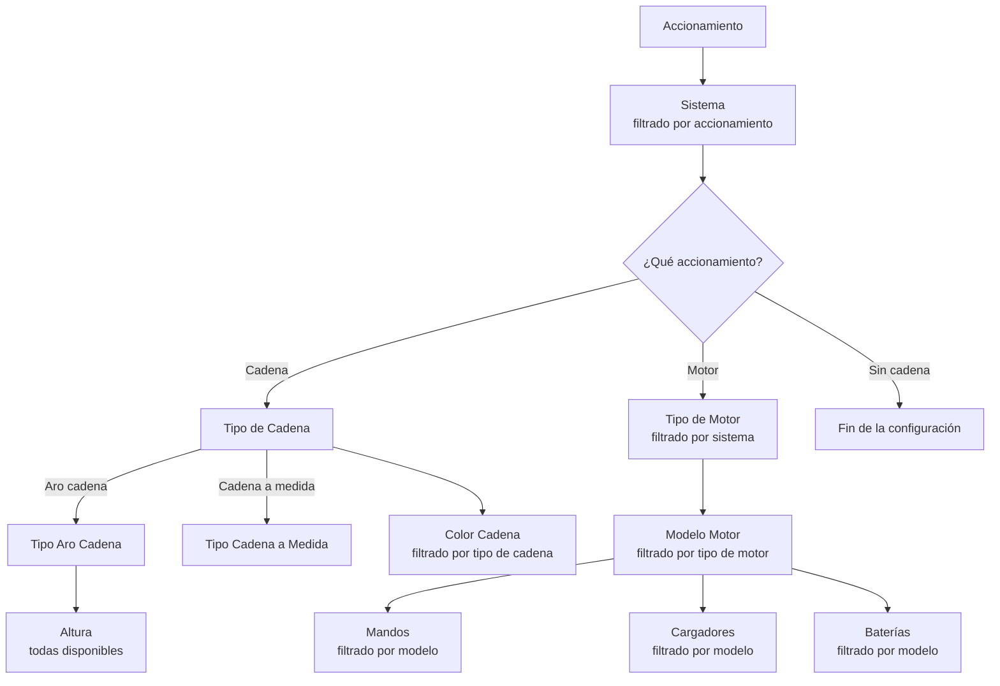
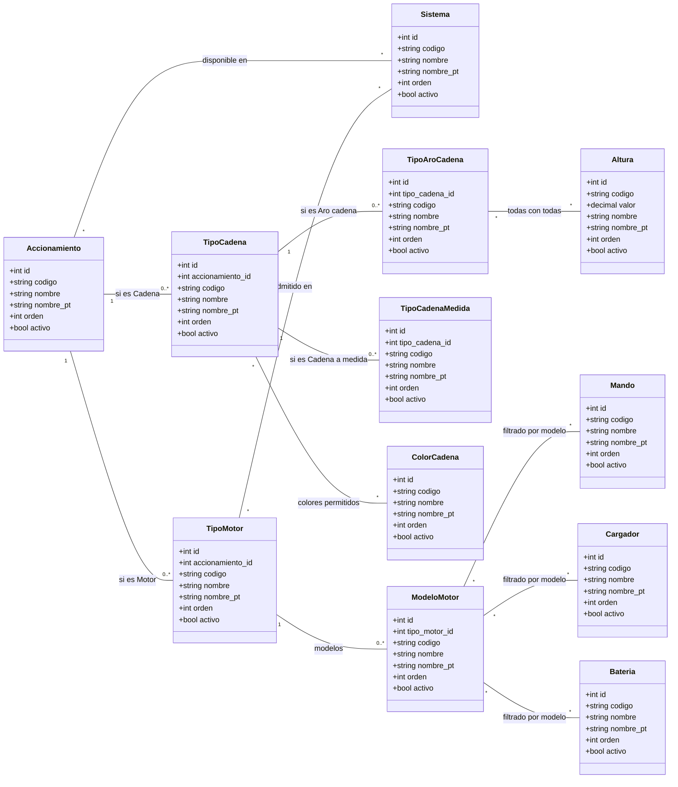

# Modelo de datos: Configurador de Accionamientos

Este documento es el registro del modelo que hay en la base de datos (tablas `SOL_ACC_*`). Si cambia el modelo, se actualiza aquí.

- **Script de creación:** `C:\dev\sqlAccionamientos\01_tablas_accionamientos.sql` (idempotente).
- **Registro de cambios y estado por entorno:** `C:\dev\sqlAccionamientos\REGISTRO_CAMBIOS.md`.
- **Mantenimiento:** pantalla "Accionamientos nuevo" (`/routes/master/accionamientos-nuevo`, permiso `config_accionamientos`), con el backend en `backend/controllers/sm/accionamientos_nuevo.js` (`/api/sm/acc/*`).

## 1. Objetivo

Estructura de datos de un configurador por pasos. El usuario elige primero un **Accionamiento** y, según esa elección, el sistema le muestra solo las opciones compatibles en los pasos siguientes: sistema, tipo de cadena, alturas, colores, motor, mandos, cargadores y baterías.

Los valores que aparecen como ejemplo (Rhin, Duero, Aro cadena...) son **registros** de las tablas, no tablas en sí mismas. Añadir un sistema o un modelo de motor es dar de alta una fila desde la pantalla, sin tocar la estructura.

El modelo es la base para configurar más adelante la fabricación por reglas (motor v3): cada catálogo tiene un `codigo` estable que se podrá usar en las condiciones. Los siguientes pasos del configurador (soportes, contrapesos...) seguirán el mismo patrón: un catálogo más una tabla N:M con `SOL_ACC_SISTEMA`.

## 2. Flujo de selección

## 3. Diagrama UML (clases)

Las relaciones muchos a muchos (`*` — `*`) se implementan con las tablas intermedias del apartado 5.

## 4. Tablas maestras

Convenciones comunes a todos los catálogos:

- Nombre de tabla: `SOL_ACC_` + nombre. Los ids son `INT IDENTITY(1,1)`.
- Todos llevan `activo` (`BIT`, por defecto 1) para retirar una opción del configurador sin borrarla y sin perder el histórico de pedidos que la usaron.
- `codigo` (`VARCHAR(50)`, único en la tabla): texto estable, solo mayúsculas, números y `_`. Se usará en las reglas de fabricación, por eso no se debe cambiar aunque se renombre el registro.
- `nombre_pt` (`VARCHAR(100)`, opcional): traducción al portugués. Si es NULL se usa el nombre en español.
- `orden` (`INT`, por defecto 0): orden en el que salen las opciones en el configurador.

### 4.1 SOL_ACC_ACCIONAMIENTO

Primer paso del configurador.

| Campo | Tipo | Restricción | Descripción |
|---|---|---|---|
| id | INT | PK, IDENTITY | Identificador |
| codigo | VARCHAR(50) | NOT NULL, UNIQUE | Código estable |
| nombre | VARCHAR(100) | NOT NULL, UNIQUE | Nombre del accionamiento |
| nombre_pt | VARCHAR(100) | NULL | Traducción PT |
| orden | INT | NOT NULL, DEFAULT 0 | Orden |
| activo | BIT | NOT NULL, DEFAULT 1 | Visible en el configurador |

Tres accionamientos son **fijos** y los crea el script `02_datos_accionamientos_fijos.sql`: Cadena (código `CADENA`), Motor (`MOTOR`) y Sin cadena (`SIN_CADENA`). La pantalla cuelga de `CADENA` los tipos de cadena y de `MOTOR` los tipos de motor; `SIN_CADENA` no abre más pasos. El backend no deja borrarlos ni cambiarles el código; sí renombrarlos u ocultarlos.

### 4.2 SOL_ACC_SISTEMA

| Campo | Tipo | Restricción | Descripción |
|---|---|---|---|
| id | INT | PK, IDENTITY | Identificador |
| codigo | VARCHAR(50) | NOT NULL, UNIQUE | Código estable |
| nombre | VARCHAR(100) | NOT NULL, UNIQUE | Nombre del sistema |
| nombre_pt | VARCHAR(100) | NULL | Traducción PT |
| orden | INT | NOT NULL, DEFAULT 0 | Orden |
| activo | BIT | NOT NULL, DEFAULT 1 | Visible en el configurador |

Valores de ejemplo: Rhin, Duero, Sena deco.

### 4.3 SOL_ACC_TIPO_CADENA

Solo aplica cuando el accionamiento es **Cadena**.

| Campo | Tipo | Restricción | Descripción |
|---|---|---|---|
| id | INT | PK, IDENTITY | Identificador |
| accionamiento_id | INT | FK → SOL_ACC_ACCIONAMIENTO.id, NOT NULL | Accionamiento al que pertenece (Cadena) |
| codigo | VARCHAR(50) | NOT NULL, UNIQUE | Código estable |
| nombre | VARCHAR(100) | NOT NULL | Nombre del tipo. Único dentro del accionamiento |
| nombre_pt | VARCHAR(100) | NULL | Traducción PT |
| orden | INT | NOT NULL, DEFAULT 0 | Orden |
| activo | BIT | NOT NULL, DEFAULT 1 | Visible en el configurador |

Dos tipos son **fijos** y los crea el script `03_datos_tipos_cadena_fijos.sql`: Aro cadena (código `ARO_CADENA`) y Cadena a medida (`CADENA_A_MEDIDA`). El backend no deja borrarlos ni cambiarles el código; sí renombrarlos u ocultarlos. Cualquier otro tipo de cadena que se añada solo tiene colores.

### 4.4 SOL_ACC_TIPO_ARO_CADENA

Solo aplica cuando el tipo de cadena es **Aro cadena** (`ARO_CADENA`): el backend no deja colgarlo de otro.

| Campo | Tipo | Restricción | Descripción |
|---|---|---|---|
| id | INT | PK, IDENTITY | Identificador |
| tipo_cadena_id | INT | FK → SOL_ACC_TIPO_CADENA.id, NOT NULL | Tipo de cadena padre (Aro cadena) |
| codigo | VARCHAR(50) | NOT NULL, UNIQUE | Código estable |
| nombre | VARCHAR(100) | NOT NULL | Nombre del tipo de aro. Único dentro del tipo de cadena |
| nombre_pt | VARCHAR(100) | NULL | Traducción PT |
| orden | INT | NOT NULL, DEFAULT 0 | Orden |
| activo | BIT | NOT NULL, DEFAULT 1 | Visible en el configurador |

### 4.5 SOL_ACC_ALTURA

Catálogo de alturas. Todas las alturas son válidas para todos los tipos de aro cadena, por lo que **no necesita tabla intermedia**: al elegir cualquier tipo de aro cadena se muestran todas las alturas activas. En la pantalla se gestionan dentro del tipo de cadena **Aro cadena** (pestaña Alturas), no en Listas de opciones.

| Campo | Tipo | Restricción | Descripción |
|---|---|---|---|
| id | INT | PK, IDENTITY | Identificador |
| codigo | VARCHAR(50) | NOT NULL, UNIQUE | Código estable |
| valor | DECIMAL(10,2) | NOT NULL, UNIQUE | Altura en **cm** (como `cad_altura` en los pedidos actuales) |
| nombre | VARCHAR(100) | NULL | Texto a mostrar, si difiere del valor |
| nombre_pt | VARCHAR(100) | NULL | Traducción PT |
| orden | INT | NOT NULL, DEFAULT 0 | Orden |
| activo | BIT | NOT NULL, DEFAULT 1 | Visible en el configurador |

### 4.6 SOL_ACC_TIPO_CADENA_MEDIDA

Solo aplica cuando el tipo de cadena es **Cadena a medida** (`CADENA_A_MEDIDA`): el backend no deja colgarlo de otro.

| Campo | Tipo | Restricción | Descripción |
|---|---|---|---|
| id | INT | PK, IDENTITY | Identificador |
| tipo_cadena_id | INT | FK → SOL_ACC_TIPO_CADENA.id, NOT NULL | Tipo de cadena padre (Cadena a medida) |
| codigo | VARCHAR(50) | NOT NULL, UNIQUE | Código estable |
| nombre | VARCHAR(100) | NOT NULL | Nombre del tipo de cadena a medida. Único dentro del tipo de cadena |
| nombre_pt | VARCHAR(100) | NULL | Traducción PT |
| orden | INT | NOT NULL, DEFAULT 0 | Orden |
| activo | BIT | NOT NULL, DEFAULT 1 | Visible en el configurador |

### 4.7 SOL_ACC_COLOR_CADENA

Catálogo de colores, compartido por Aro cadena y Cadena a medida.

| Campo | Tipo | Restricción | Descripción |
|---|---|---|---|
| id | INT | PK, IDENTITY | Identificador |
| codigo | VARCHAR(50) | NOT NULL, UNIQUE | Código estable |
| nombre | VARCHAR(100) | NOT NULL, UNIQUE | Nombre del color |
| nombre_pt | VARCHAR(100) | NULL | Traducción PT |
| orden | INT | NOT NULL, DEFAULT 0 | Orden |
| activo | BIT | NOT NULL, DEFAULT 1 | Visible en el configurador |

### 4.8 SOL_ACC_TIPO_MOTOR

Solo aplica cuando el accionamiento es **Motor**.

| Campo | Tipo | Restricción | Descripción |
|---|---|---|---|
| id | INT | PK, IDENTITY | Identificador |
| accionamiento_id | INT | FK → SOL_ACC_ACCIONAMIENTO.id, NOT NULL | Accionamiento al que pertenece (Motor) |
| codigo | VARCHAR(50) | NOT NULL, UNIQUE | Código estable |
| nombre | VARCHAR(100) | NOT NULL | Nombre del tipo de motor. Único dentro del accionamiento |
| nombre_pt | VARCHAR(100) | NULL | Traducción PT |
| orden | INT | NOT NULL, DEFAULT 0 | Orden |
| activo | BIT | NOT NULL, DEFAULT 1 | Visible en el configurador |

### 4.9 SOL_ACC_MODELO_MOTOR

Las opciones mostradas dependen del tipo de motor elegido.

| Campo | Tipo | Restricción | Descripción |
|---|---|---|---|
| id | INT | PK, IDENTITY | Identificador |
| tipo_motor_id | INT | FK → SOL_ACC_TIPO_MOTOR.id, NOT NULL | Tipo de motor al que pertenece |
| codigo | VARCHAR(50) | NOT NULL, UNIQUE | Código estable |
| nombre | VARCHAR(100) | NOT NULL | Nombre del modelo. Único dentro del tipo de motor |
| nombre_pt | VARCHAR(100) | NULL | Traducción PT |
| orden | INT | NOT NULL, DEFAULT 0 | Orden |
| activo | BIT | NOT NULL, DEFAULT 1 | Visible en el configurador |

### 4.10 SOL_ACC_MANDO, SOL_ACC_CARGADOR y SOL_ACC_BATERIA

Las tres tablas tienen la misma estructura. Sus opciones se **filtran por el modelo de motor** elegido: al seleccionar un modelo, solo aparecen los mandos, cargadores y baterías asociados a ese modelo (ver tablas intermedias).

| Campo | Tipo | Restricción | Descripción |
|---|---|---|---|
| id | INT | PK, IDENTITY | Identificador |
| codigo | VARCHAR(50) | NOT NULL, UNIQUE | Código estable |
| nombre | VARCHAR(100) | NOT NULL, UNIQUE | Nombre del mando / cargador / batería |
| nombre_pt | VARCHAR(100) | NULL | Traducción PT |
| orden | INT | NOT NULL, DEFAULT 0 | Orden |
| activo | BIT | NOT NULL, DEFAULT 1 | Visible en el configurador |

## 5. Tablas intermedias (relaciones muchos a muchos)

Se usan cuando una opción puede servir para varios elementos del paso anterior. Por ejemplo, un mismo mando puede ser compatible con varios modelos de motor, y un modelo de motor admite varios mandos. Todas tienen clave primaria compuesta por sus dos claves foráneas, lo que impide duplicados.

| Tabla | Campo 1 (PK, FK) | Campo 2 (PK, FK) | Qué resuelve |
|---|---|---|---|
| SOL_ACC_ACCIONAMIENTO_SISTEMA | accionamiento_id → SOL_ACC_ACCIONAMIENTO.id | sistema_id → SOL_ACC_SISTEMA.id | Qué sistemas aparecen para cada accionamiento |
| SOL_ACC_TIPO_MOTOR_SISTEMA | tipo_motor_id → SOL_ACC_TIPO_MOTOR.id | sistema_id → SOL_ACC_SISTEMA.id | Qué tipos de motor admite cada sistema |
| SOL_ACC_TIPO_CADENA_COLOR | tipo_cadena_id → SOL_ACC_TIPO_CADENA.id | color_cadena_id → SOL_ACC_COLOR_CADENA.id | Qué colores aparecen para Aro cadena y para Cadena a medida |
| SOL_ACC_MODELO_MOTOR_MANDO | modelo_motor_id → SOL_ACC_MODELO_MOTOR.id | mando_id → SOL_ACC_MANDO.id | Qué mandos aparecen para cada modelo |
| SOL_ACC_MODELO_MOTOR_CARGADOR | modelo_motor_id → SOL_ACC_MODELO_MOTOR.id | cargador_id → SOL_ACC_CARGADOR.id | Qué cargadores aparecen para cada modelo |
| SOL_ACC_MODELO_MOTOR_BATERIA | modelo_motor_id → SOL_ACC_MODELO_MOTOR.id | bateria_id → SOL_ACC_BATERIA.id | Qué baterías aparecen para cada modelo |

## 6. Resumen de relaciones

| Origen | Destino | Cardinalidad | Implementación |
|---|---|---|---|
| Accionamiento | Sistema | N:M | Tabla SOL_ACC_ACCIONAMIENTO_SISTEMA |
| Accionamiento (Cadena) | Tipo de Cadena | 1:N | FK `accionamiento_id` en SOL_ACC_TIPO_CADENA |
| Tipo de Cadena (Aro cadena) | Tipo Aro Cadena | 1:N | FK `tipo_cadena_id` en SOL_ACC_TIPO_ARO_CADENA |
| Tipo Aro Cadena | Altura | Todas con todas | Sin tabla intermedia |
| Tipo de Cadena (Cadena a medida) | Tipo Cadena a Medida | 1:N | FK `tipo_cadena_id` en SOL_ACC_TIPO_CADENA_MEDIDA |
| Tipo de Cadena | Color Cadena | N:M | Tabla SOL_ACC_TIPO_CADENA_COLOR |
| Accionamiento (Motor) | Tipo de Motor | 1:N | FK `accionamiento_id` en SOL_ACC_TIPO_MOTOR |
| Tipo de Motor | Sistema | N:M | Tabla SOL_ACC_TIPO_MOTOR_SISTEMA |
| Tipo de Motor | Modelo Motor | 1:N | FK `tipo_motor_id` en SOL_ACC_MODELO_MOTOR |
| Modelo Motor | Mando | N:M | Tabla SOL_ACC_MODELO_MOTOR_MANDO |
| Modelo Motor | Cargador | N:M | Tabla SOL_ACC_MODELO_MOTOR_CARGADOR |
| Modelo Motor | Batería | N:M | Tabla SOL_ACC_MODELO_MOTOR_BATERIA |

"Sin cadena" solo se relaciona con Sistema; no abre más pasos.

## 7. Reglas de negocio

1. Un tipo de cadena solo puede colgar del accionamiento de código `CADENA`, y un tipo de motor solo del de código `MOTOR`. Un tipo de aro cadena solo puede colgar del tipo de cadena `ARO_CADENA`, y un tipo de cadena a medida solo de `CADENA_A_MEDIDA`. La FK garantiza que el padre existe. Que el padre sea el correcto lo valida el **backend** (la base de datos no lo fuerza), y el padre de un registro no se puede cambiar al editarlo.
2. En cada paso solo se muestran registros con `activo = 1`.
3. Si se añade una altura nueva, aparece automáticamente para todos los tipos de aro cadena.
4. Mandos, cargadores y baterías son opcionales por modelo: si un modelo de motor no tiene ninguno marcado, ese paso no se muestra en el configurador.
5. Un registro del que dependen otros (hijos o relaciones marcadas) no se puede borrar: se desactiva (`activo = 0`).

## 8. Cómo se guarda en el pedido

El configurador nuevo solo lo usan los clientes con fila activa en `SOL_ACC_CLIENTE (cliente, activo)` (script 04). Leroy Merlín (clientes 1 y 5) no tiene fila y sigue con el configurador de siempre.

Las líneas de enrollable del flujo nuevo se graban en `SOL_PEDIDOS_COLA_TIPO_1`, como las de siempre, con los SPs `sp_acc_pedido_add` y `sp_acc_pedido_tipo_1_add` (script 06):

- La selección va en 12 columnas nulables `nacc_*` (script 05), con FK a su catálogo: `nacc_accionamiento_id`, `nacc_sistema_id`, `nacc_tipo_cadena_id`, `nacc_tipo_aro_id`, `nacc_cadena_medida_id`, `nacc_altura_id`, `nacc_color_cadena_id`, `nacc_tipo_motor_id`, `nacc_modelo_motor_id`, `nacc_mando_id`, `nacc_cargador_id`, `nacc_bateria_id`. En las líneas de siempre quedan a NULL.
- Los ids antiguos de accionamiento (`acc_tipo_id`, `acc_marca_id`, `acc_modelo_id`, `mando_id`, `cargador`, `cad_altura_id`, `cad_color_id`) van a -1: nunca se mezclan ids nuevos con los antiguos.
- Los textos que pintan la cesta, los pedidos y los informes se escriben desde `SOL_ACC_*`: `acc_tipo_text` (accionamiento), `acc_marca_text` (sistema; en motor, "sistema · tipo de motor"), `acc_modelo_text` (cadena: "tipo · aro o medida"; motor: "modelo · cargador · batería"), `mando_text`, `cad_Tipo` = 1, `cad_Altura` ("100 cm" o el tipo de medida) y `cad_color_text`.
- El SP valida la combinación (sistema del accionamiento, tipo de cadena y sus hijos, colores permitidos, tipo de motor admitido en el sistema, modelo y sus mandos, cargadores y baterías).
- De momento sin precio: los importes `T1_*` quedan a NULL hasta tener las tarifas del modelo nuevo.

## 9. Pendiente

- Visibilidad por cliente (tablas `X_CLIENTE`), si se necesita.
- Cómo guardará el pedido la selección (columnas con los ids de cada paso).
- Siguientes pasos del configurador: soportes (un sistema tiene varios soportes a elegir), contrapesos, tapas, tejido...
