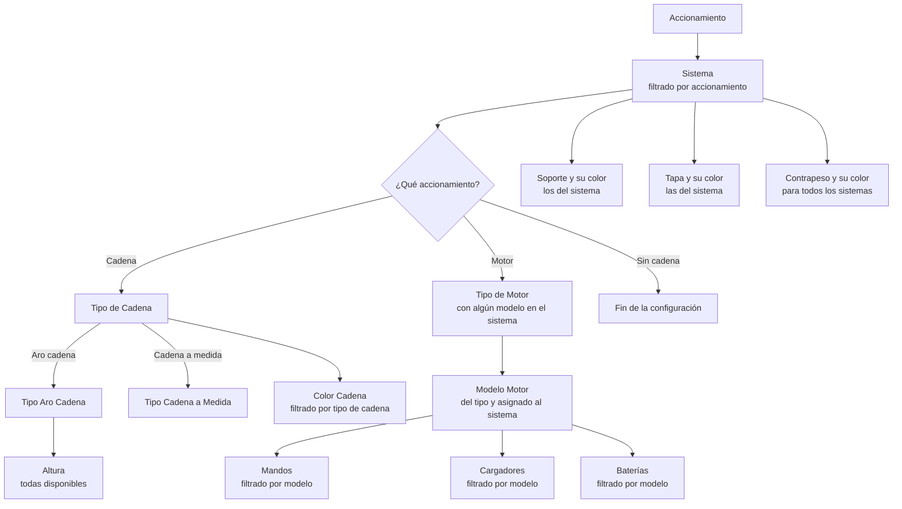
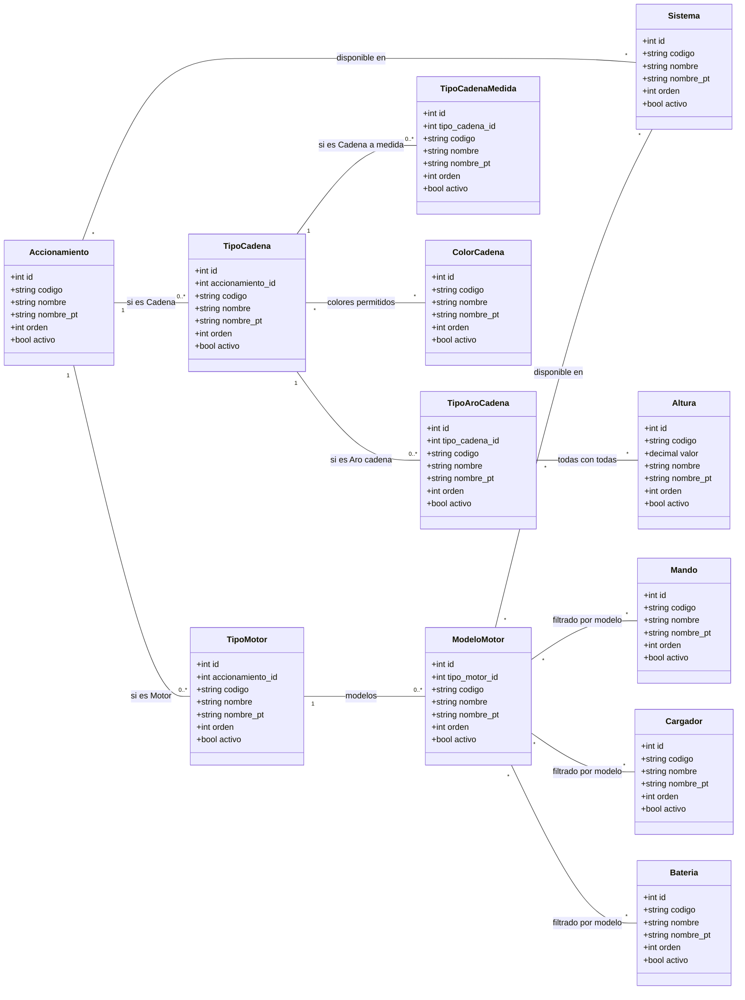
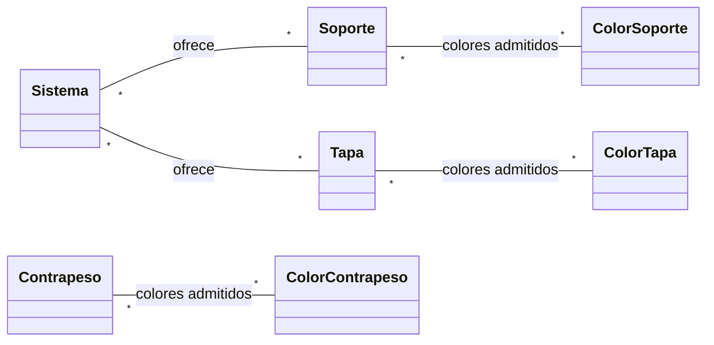
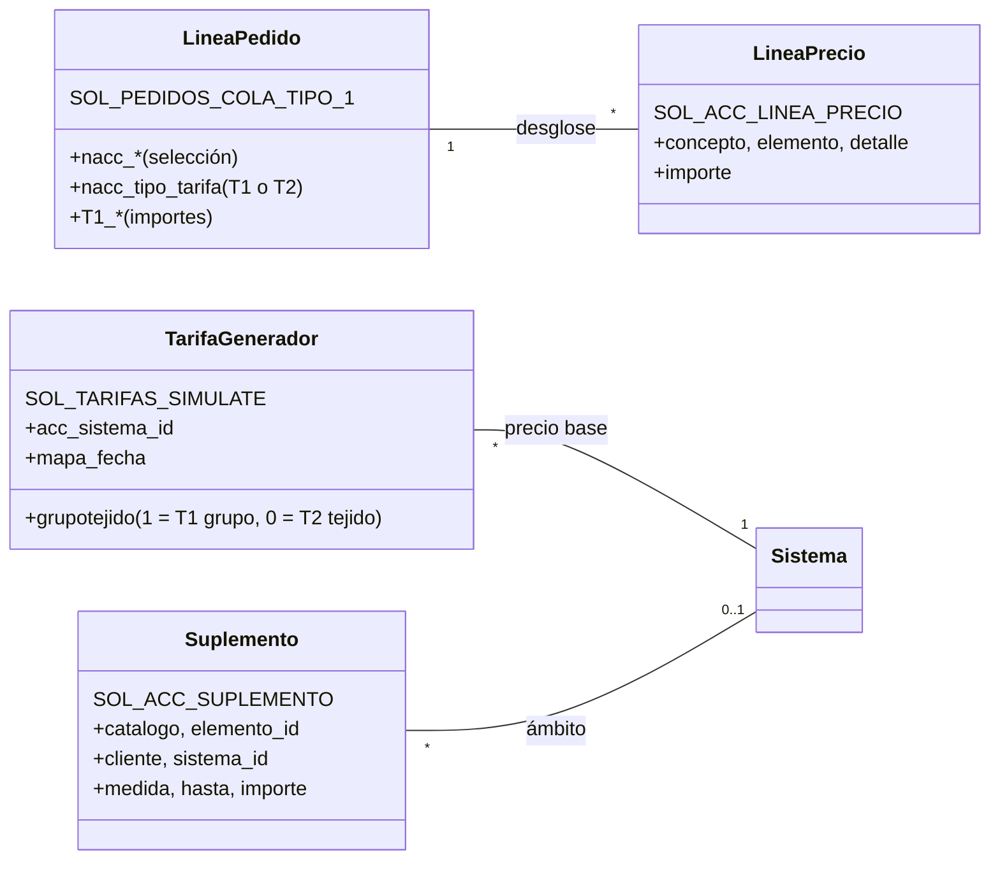

# Modelo de datos: Configurador de Accionamientos

Este documento es el registro del modelo que hay en la base de datos (tablas `SOL_ACC_*`). Si cambia el modelo, se actualiza aquí.

- **Scripts:** `C:\dev\sqlAccionamientos\01` a `29` (idempotentes; del 29 al 33 requieren el maestro de tejidos y se despliegan aparte, ver `DESPLIEGUE.md` 4b). Se despliegan todos en orden con `00_desplegar_todo.sql` (o `00_desplegar_todo_ssms.sql` desde SSMS); ver `DESPLIEGUE.md`. Desplegados en producción el 2026-10-21.
- **Registro de cambios y estado por entorno:** `C:\dev\sqlAccionamientos\REGISTRO_CAMBIOS.md`.
- **Mantenimiento:** pantalla "Productos" (antes "Accionamientos nuevo"; `/routes/master/accionamientos-nuevo`, permiso `config_accionamientos`), con el backend en `backend/controllers/sm/accionamientos_nuevo.js` (`/api/sm/acc/*`).
- **Configurador nuevo:** componente `manza/enrollable-nuevo`, backend `backend/controllers/sm/acc_configurador.js` (`/api/sm/acc_cfg/*`). Solo para clientes con el interruptor activo (apartado 4.13).
- **Fabricación:** cada sistema tiene su propio juego de reglas en el motor v3 (apartado 10).

## 1. Objetivo

Estructura de datos de un configurador por pasos. El usuario elige primero un **Accionamiento** y, según esa elección, el sistema le muestra solo las opciones compatibles en los pasos siguientes: sistema, tipo de cadena, alturas, colores, motor, mandos, cargadores y baterías.

Los valores que aparecen como ejemplo (Rhin, Duero, Aro cadena...) son **registros** de las tablas, no tablas en sí mismas. Añadir un sistema o un modelo de motor es dar de alta una fila desde la pantalla, sin tocar la estructura.

El modelo es la base para configurar más adelante la fabricación por reglas (motor v3): cada catálogo tiene un `codigo` estable que se podrá usar en las condiciones. Los siguientes pasos del configurador (soportes, contrapesos...) seguirán el mismo patrón: un catálogo más una tabla N:M con `SOL_ACC_SISTEMA`.

## 2. Flujo de selección

Además de estos pasos, la línea lleva la posición del accionamiento, la estancia, la impresión digital y el tejido (columnas de siempre), y el precio se calcula con la tarifa elegida, T1 o T2 (apartado 9).

## 3. Diagrama UML (clases)

Las relaciones muchos a muchos (`*` — `*`) se implementan con las tablas intermedias del apartado 5.

Piezas del sistema (script 07). Cada pieza tiene su propio catálogo de colores:

Precio de una línea (apartado 9):

## 4. Tablas maestras

Convenciones comunes a todos los catálogos:

- Nombre de tabla: `SOL_ACC_` + nombre. Los ids son `INT IDENTITY(1,1)`.
- Todos llevan `activo` (`BIT`, por defecto 1) para retirar una opción del configurador sin borrarla y sin perder el histórico de pedidos que la usaron.
- `codigo` (`VARCHAR(50)`, único en la tabla): texto estable, solo mayúsculas, números y `_`. Se usará en las reglas de fabricación, por eso no se debe cambiar aunque se renombre el registro.
- `nombre_pt` (`VARCHAR(100)`, opcional): traducción al portugués. Si es NULL se usa el nombre en español.
- `orden` (`INT`, por defecto 0): orden en el que salen las opciones en el configurador.

### 4.1 SOL_ACC_ACCIONAMIENTO

Primer paso del configurador.

| Campo | Tipo | Restricción | Descripción |
|---|---|---|---|
| id | INT | PK, IDENTITY | Identificador |
| codigo | VARCHAR(50) | NOT NULL, UNIQUE | Código estable |
| nombre | VARCHAR(100) | NOT NULL, UNIQUE | Nombre del accionamiento |
| nombre_pt | VARCHAR(100) | NULL | Traducción PT |
| orden | INT | NOT NULL, DEFAULT 0 | Orden |
| activo | BIT | NOT NULL, DEFAULT 1 | Visible en el configurador |

Tres accionamientos son **fijos** y los crea el script `02_datos_accionamientos_fijos.sql`: Cadena (código `CADENA`), Motor (`MOTOR`) y Sin cadena (`SIN_CADENA`). La pantalla cuelga de `CADENA` los tipos de cadena y de `MOTOR` los tipos de motor; `SIN_CADENA` no abre más pasos. El backend no deja borrarlos ni cambiarles el código; sí renombrarlos u ocultarlos.

### 4.2 SOL_ACC_SISTEMA

| Campo | Tipo | Restricción | Descripción |
|---|---|---|---|
| id | INT | PK, IDENTITY | Identificador |
| codigo | VARCHAR(50) | NOT NULL, UNIQUE | Código estable |
| nombre | VARCHAR(100) | NOT NULL, UNIQUE | Nombre del sistema |
| nombre_pt | VARCHAR(100) | NULL | Traducción PT |
| orden | INT | NOT NULL, DEFAULT 0 | Orden |
| activo | BIT | NOT NULL, DEFAULT 1 | Visible en el configurador |
| sp_modelo | VARCHAR(50) | NULL | **Sin uso desde el script 25.** Era la familia de tarifa del generador (script 17). Ahora el enlace va al revés: la tarifa del generador guarda su sistema (`SOL_TARIFAS_SIMULATE.acc_sistema_id`). Se borrará en el renombrado final |

Valores de ejemplo: Rhin, Duero, Sena deco.

El sistema también decide qué juego de reglas de fabricación se usa (apartado 10).

### 4.3 SOL_ACC_TIPO_CADENA

Solo aplica cuando el accionamiento es **Cadena**.

| Campo | Tipo | Restricción | Descripción |
|---|---|---|---|
| id | INT | PK, IDENTITY | Identificador |
| accionamiento_id | INT | FK → SOL_ACC_ACCIONAMIENTO.id, NOT NULL | Accionamiento al que pertenece (Cadena) |
| codigo | VARCHAR(50) | NOT NULL, UNIQUE | Código estable |
| nombre | VARCHAR(100) | NOT NULL | Nombre del tipo. Único dentro del accionamiento |
| nombre_pt | VARCHAR(100) | NULL | Traducción PT |
| orden | INT | NOT NULL, DEFAULT 0 | Orden |
| activo | BIT | NOT NULL, DEFAULT 1 | Visible en el configurador |

Dos tipos son **fijos** y los crea el script `03_datos_tipos_cadena_fijos.sql`: Aro cadena (código `ARO_CADENA`) y Cadena a medida (`CADENA_A_MEDIDA`). El backend no deja borrarlos ni cambiarles el código; sí renombrarlos u ocultarlos. Cualquier otro tipo de cadena que se añada solo tiene colores.

### 4.4 SOL_ACC_TIPO_ARO_CADENA

Solo aplica cuando el tipo de cadena es **Aro cadena** (`ARO_CADENA`): el backend no deja colgarlo de otro.

| Campo | Tipo | Restricción | Descripción |
|---|---|---|---|
| id | INT | PK, IDENTITY | Identificador |
| tipo_cadena_id | INT | FK → SOL_ACC_TIPO_CADENA.id, NOT NULL | Tipo de cadena padre (Aro cadena) |
| codigo | VARCHAR(50) | NOT NULL, UNIQUE | Código estable |
| nombre | VARCHAR(100) | NOT NULL | Nombre del tipo de aro. Único dentro del tipo de cadena |
| nombre_pt | VARCHAR(100) | NULL | Traducción PT |
| orden | INT | NOT NULL, DEFAULT 0 | Orden |
| activo | BIT | NOT NULL, DEFAULT 1 | Visible en el configurador |

### 4.5 SOL_ACC_ALTURA

Catálogo de alturas. Todas las alturas son válidas para todos los tipos de aro cadena, por lo que **no necesita tabla intermedia**: al elegir cualquier tipo de aro cadena se muestran todas las alturas activas. En la pantalla se gestionan dentro del tipo de cadena **Aro cadena** (pestaña Alturas), no en Listas de opciones.

| Campo | Tipo | Restricción | Descripción |
|---|---|---|---|
| id | INT | PK, IDENTITY | Identificador |
| codigo | VARCHAR(50) | NOT NULL, UNIQUE | Código estable |
| valor | DECIMAL(10,2) | NOT NULL, UNIQUE | Altura en **cm** (como `cad_altura` en los pedidos actuales) |
| nombre | VARCHAR(100) | NULL | Texto a mostrar, si difiere del valor |
| nombre_pt | VARCHAR(100) | NULL | Traducción PT |
| orden | INT | NOT NULL, DEFAULT 0 | Orden |
| activo | BIT | NOT NULL, DEFAULT 1 | Visible en el configurador |

### 4.6 SOL_ACC_TIPO_CADENA_MEDIDA

Solo aplica cuando el tipo de cadena es **Cadena a medida** (`CADENA_A_MEDIDA`): el backend no deja colgarlo de otro.

| Campo | Tipo | Restricción | Descripción |
|---|---|---|---|
| id | INT | PK, IDENTITY | Identificador |
| tipo_cadena_id | INT | FK → SOL_ACC_TIPO_CADENA.id, NOT NULL | Tipo de cadena padre (Cadena a medida) |
| codigo | VARCHAR(50) | NOT NULL, UNIQUE | Código estable |
| nombre | VARCHAR(100) | NOT NULL | Nombre del tipo de cadena a medida. Único dentro del tipo de cadena |
| nombre_pt | VARCHAR(100) | NULL | Traducción PT |
| orden | INT | NOT NULL, DEFAULT 0 | Orden |
| activo | BIT | NOT NULL, DEFAULT 1 | Visible en el configurador |

### 4.7 SOL_ACC_COLOR_CADENA

Catálogo de colores, compartido por Aro cadena y Cadena a medida.

| Campo | Tipo | Restricción | Descripción |
|---|---|---|---|
| id | INT | PK, IDENTITY | Identificador |
| codigo | VARCHAR(50) | NOT NULL, UNIQUE | Código estable |
| nombre | VARCHAR(100) | NOT NULL, UNIQUE | Nombre del color |
| nombre_pt | VARCHAR(100) | NULL | Traducción PT |
| orden | INT | NOT NULL, DEFAULT 0 | Orden |
| activo | BIT | NOT NULL, DEFAULT 1 | Visible en el configurador |

### 4.8 SOL_ACC_TIPO_MOTOR

Solo aplica cuando el accionamiento es **Motor**.

| Campo | Tipo | Restricción | Descripción |
|---|---|---|---|
| id | INT | PK, IDENTITY | Identificador |
| accionamiento_id | INT | FK → SOL_ACC_ACCIONAMIENTO.id, NOT NULL | Accionamiento al que pertenece (Motor) |
| codigo | VARCHAR(50) | NOT NULL, UNIQUE | Código estable |
| nombre | VARCHAR(100) | NOT NULL | Nombre del tipo de motor. Único dentro del accionamiento |
| nombre_pt | VARCHAR(100) | NULL | Traducción PT |
| orden | INT | NOT NULL, DEFAULT 0 | Orden |
| activo | BIT | NOT NULL, DEFAULT 1 | Visible en el configurador |

### 4.9 SOL_ACC_MODELO_MOTOR

Las opciones mostradas dependen del tipo de motor elegido y del sistema: solo salen los modelos asignados al sistema (`SOL_ACC_MODELO_MOTOR_SISTEMA`, script 14). Un tipo de motor aparece en un sistema si alguno de sus modelos está asignado a él.

| Campo | Tipo | Restricción | Descripción |
|---|---|---|---|
| id | INT | PK, IDENTITY | Identificador |
| tipo_motor_id | INT | FK → SOL_ACC_TIPO_MOTOR.id, NOT NULL | Tipo de motor al que pertenece |
| codigo | VARCHAR(50) | NOT NULL, UNIQUE | Código estable |
| nombre | VARCHAR(100) | NOT NULL | Nombre del modelo. Único dentro del tipo de motor |
| nombre_pt | VARCHAR(100) | NULL | Traducción PT |
| orden | INT | NOT NULL, DEFAULT 0 | Orden |
| activo | BIT | NOT NULL, DEFAULT 1 | Visible en el configurador |

### 4.10 SOL_ACC_MANDO, SOL_ACC_CARGADOR y SOL_ACC_BATERIA

Las tres tablas tienen la misma estructura. Sus opciones se **filtran por el modelo de motor** elegido: al seleccionar un modelo, solo aparecen los mandos, cargadores y baterías asociados a ese modelo (ver tablas intermedias).

| Campo | Tipo | Restricción | Descripción |
|---|---|---|---|
| id | INT | PK, IDENTITY | Identificador |
| codigo | VARCHAR(50) | NOT NULL, UNIQUE | Código estable |
| nombre | VARCHAR(100) | NOT NULL, UNIQUE | Nombre del mando / cargador / batería |
| nombre_pt | VARCHAR(100) | NULL | Traducción PT |
| orden | INT | NOT NULL, DEFAULT 0 | Orden |
| activo | BIT | NOT NULL, DEFAULT 1 | Visible en el configurador |

### 4.11 SOL_ACC_SOPORTE, SOL_ACC_TAPA y SOL_ACC_CONTRAPESO

Script 07. Las tres tablas tienen la estructura común de los catálogos (`id`, `codigo`, `nombre` único, `nombre_pt`, `orden`, `activo`).

- **Soportes genéricos** (p. ej. "Corto", "Largo"): cada sistema marca los que ofrece (`SOL_ACC_SOPORTE_SISTEMA`). La fabricación distinguirá por sistema y soporte.
- **Tapas**: dependen solo del sistema (`SOL_ACC_TAPA_SISTEMA`), no del soporte.
- **Contrapesos**: valen para todos los sistemas; no tienen relación con el sistema.

### 4.12 Colores de soporte, tapa y contrapeso

`SOL_ACC_COLOR_SOPORTE`, `SOL_ACC_COLOR_TAPA` y `SOL_ACC_COLOR_CONTRAPESO` (script 07): un catálogo de colores **por pieza**, con la estructura común. El usuario elige un color para cada pieza (cadena, soporte, tapa y contrapeso), y cada pieza marca qué colores de su catálogo admite.

### 4.14 SOL_ACC_PRODUCTO_TEJIDO (tejidos disponibles)

Script 29. Qué tejidos del maestro de tejidos (`SOL_TEJIDOS_MAESTRO`, una fila por tejido + color; ver `tejidos.md`) se ofrecen en cada producto del configurador. Se mantiene en el apartado **Tejidos** de la pantalla Productos.

| Campo | Tipo | Restricción | Descripción |
|---|---|---|---|
| producto | INT | PK, FK → SOL_ARTICULOS_PRODUCTOS.idrow | 1 = enrollable (el único de momento) |
| tejido | INT | PK, FK → SOL_TEJIDOS_MAESTRO.idrow (on delete cascade) | Tejido + color disponible |
| created | DATETIME | NOT NULL, DEFAULT getdate() | Alta |
| usuario | VARCHAR(100) | NULL | Email del usuario que lo marcó (el token no lleva id) |

- Una sola lista para todos los clientes (decisión del usuario, 2026-10-23).
- En la pantalla los tejidos se agrupan solo por nombre, sin distinguir el criterio: marcar VERA BLOCK marca sus colores de 200, de 250 y de cualquier otro ancho (decisión del usuario, 2026-10-23).
- **El configurador nuevo ofrece solo estos tejidos** (scripts 30-32, 2026-10-23): tipo de tejido → tejido → color; el criterio no se elige: el configurador toma, entre los anchos de ese tejido + color, el menor que cubra el ancho de la cortina (si ninguno, "supera el ancho máximo"). Con impresión digital, solo los que la admiten en el maestro. La línea lo guarda en `nacc_tejido_id` (apartado 8) y el precio usa su grupo (T1) o la T2 de su tejido + criterio (apartado 9).

### 4.13 SOL_ACC_CLIENTE (interruptor por cliente)

Script 04. Decide qué clientes usan el configurador nuevo.

| Campo | Tipo | Restricción | Descripción |
|---|---|---|---|
| cliente | INT | PK, FK → SOL_CLIENTES.idrow | Cliente (empresa) |
| activo | BIT | NOT NULL | 1 = usa el configurador nuevo |

- Sin fila (o con `activo = 0`), el cliente sigue con el configurador de siempre. Leroy (1 y 5) **nunca** tiene fila.
- El interruptor es por **empresa**, no por usuario: los usuarios internos (tabla `USERS`) trabajan como cliente 4; los usuarios cliente (`CLIENTES_USERS`), con su empresa. Un usuario cliente con empresa -1 también cuenta como cliente 4.
- Con el cliente activo, **todo** su documento va por el flujo nuevo, que de momento solo admite enrollables (sin cesta mixta).
- En producción, desde el 2026-10-21: cliente 4 activo.

## 5. Tablas intermedias (relaciones muchos a muchos)

Se usan cuando una opción puede servir para varios elementos del paso anterior. Por ejemplo, un mismo mando puede ser compatible con varios modelos de motor, y un modelo de motor admite varios mandos. Todas tienen clave primaria compuesta por sus dos claves foráneas, lo que impide duplicados.

| Tabla | Campo 1 (PK, FK) | Campo 2 (PK, FK) | Qué resuelve |
|---|---|---|---|
| SOL_ACC_ACCIONAMIENTO_SISTEMA | accionamiento_id → SOL_ACC_ACCIONAMIENTO.id | sistema_id → SOL_ACC_SISTEMA.id | Qué sistemas aparecen para cada accionamiento |
| SOL_ACC_MODELO_MOTOR_SISTEMA | modelo_motor_id → SOL_ACC_MODELO_MOTOR.id | sistema_id → SOL_ACC_SISTEMA.id | Qué motores (modelos) ofrece cada sistema. Script 14; sustituye a `SOL_ACC_TIPO_MOTOR_SISTEMA` (relación por tipo, borrada) |
| SOL_ACC_TIPO_CADENA_COLOR | tipo_cadena_id → SOL_ACC_TIPO_CADENA.id | color_cadena_id → SOL_ACC_COLOR_CADENA.id | Qué colores aparecen para Aro cadena y para Cadena a medida |
| SOL_ACC_MODELO_MOTOR_MANDO | modelo_motor_id → SOL_ACC_MODELO_MOTOR.id | mando_id → SOL_ACC_MANDO.id | Qué mandos aparecen para cada modelo |
| SOL_ACC_MODELO_MOTOR_CARGADOR | modelo_motor_id → SOL_ACC_MODELO_MOTOR.id | cargador_id → SOL_ACC_CARGADOR.id | Qué cargadores aparecen para cada modelo |
| SOL_ACC_MODELO_MOTOR_BATERIA | modelo_motor_id → SOL_ACC_MODELO_MOTOR.id | bateria_id → SOL_ACC_BATERIA.id | Qué baterías aparecen para cada modelo |
| SOL_ACC_SOPORTE_SISTEMA | soporte_id → SOL_ACC_SOPORTE.id | sistema_id → SOL_ACC_SISTEMA.id | Qué soportes ofrece cada sistema |
| SOL_ACC_TAPA_SISTEMA | tapa_id → SOL_ACC_TAPA.id | sistema_id → SOL_ACC_SISTEMA.id | Qué tapas ofrece cada sistema |
| SOL_ACC_SOPORTE_COLOR | soporte_id → SOL_ACC_SOPORTE.id | color_soporte_id → SOL_ACC_COLOR_SOPORTE.id | Colores que admite cada soporte |
| SOL_ACC_TAPA_COLOR | tapa_id → SOL_ACC_TAPA.id | color_tapa_id → SOL_ACC_COLOR_TAPA.id | Colores que admite cada tapa |
| SOL_ACC_CONTRAPESO_COLOR | contrapeso_id → SOL_ACC_CONTRAPESO.id | color_contrapeso_id → SOL_ACC_COLOR_CONTRAPESO.id | Colores que admite cada contrapeso |

## 6. Resumen de relaciones

| Origen | Destino | Cardinalidad | Implementación |
|---|---|---|---|
| Accionamiento | Sistema | N:M | Tabla SOL_ACC_ACCIONAMIENTO_SISTEMA |
| Accionamiento (Cadena) | Tipo de Cadena | 1:N | FK `accionamiento_id` en SOL_ACC_TIPO_CADENA |
| Tipo de Cadena (Aro cadena) | Tipo Aro Cadena | 1:N | FK `tipo_cadena_id` en SOL_ACC_TIPO_ARO_CADENA |
| Tipo Aro Cadena | Altura | Todas con todas | Sin tabla intermedia |
| Tipo de Cadena (Cadena a medida) | Tipo Cadena a Medida | 1:N | FK `tipo_cadena_id` en SOL_ACC_TIPO_CADENA_MEDIDA |
| Tipo de Cadena | Color Cadena | N:M | Tabla SOL_ACC_TIPO_CADENA_COLOR |
| Accionamiento (Motor) | Tipo de Motor | 1:N | FK `accionamiento_id` en SOL_ACC_TIPO_MOTOR |
| Modelo Motor | Sistema | N:M | Tabla SOL_ACC_MODELO_MOTOR_SISTEMA (el tipo se deduce de sus modelos) |
| Tipo de Motor | Modelo Motor | 1:N | FK `tipo_motor_id` en SOL_ACC_MODELO_MOTOR |
| Modelo Motor | Mando | N:M | Tabla SOL_ACC_MODELO_MOTOR_MANDO |
| Modelo Motor | Cargador | N:M | Tabla SOL_ACC_MODELO_MOTOR_CARGADOR |
| Modelo Motor | Batería | N:M | Tabla SOL_ACC_MODELO_MOTOR_BATERIA |
| Sistema | Soporte | N:M | Tabla SOL_ACC_SOPORTE_SISTEMA |
| Sistema | Tapa | N:M | Tabla SOL_ACC_TAPA_SISTEMA |
| Contrapeso | (todos los sistemas) | — | Sin relación |
| Soporte / Tapa / Contrapeso | Su color | N:M | SOL_ACC_SOPORTE_COLOR, SOL_ACC_TAPA_COLOR, SOL_ACC_CONTRAPESO_COLOR |

"Sin cadena" solo se relaciona con Sistema; no abre más pasos.

## 7. Reglas de negocio

1. Un tipo de cadena solo puede colgar del accionamiento de código `CADENA`, y un tipo de motor solo del de código `MOTOR`. Un tipo de aro cadena solo puede colgar del tipo de cadena `ARO_CADENA`, y un tipo de cadena a medida solo de `CADENA_A_MEDIDA`. La FK garantiza que el padre existe. Que el padre sea el correcto lo valida el **backend** (la base de datos no lo fuerza), y el padre de un registro no se puede cambiar al editarlo.
2. En cada paso solo se muestran registros con `activo = 1`.
3. Si se añade una altura nueva, aparece automáticamente para todos los tipos de aro cadena.
4. Mandos, cargadores y baterías son opcionales por modelo: si un modelo de motor no tiene ninguno marcado, ese paso no se muestra en el configurador.
5. Un registro del que dependen otros (hijos o relaciones marcadas) no se puede borrar: se desactiva (`activo = 0`).

## 8. Cómo se guarda en el pedido

El configurador nuevo solo lo usan los clientes con fila activa en `SOL_ACC_CLIENTE (cliente, activo)` (script 04). Leroy Merlín (clientes 1 y 5) no tiene fila y sigue con el configurador de siempre.

Las líneas de enrollable del flujo nuevo se graban en `SOL_PEDIDOS_COLA_TIPO_1`, como las de siempre, con los SPs `sp_acc_pedido_add` y `sp_acc_pedido_tipo_1_add` (creados en el 06; versión vigente: script 28):

- La selección va en 19 columnas nulables `nacc_*` (12 del script 05, 6 del 08 y `nacc_cadena_longitud` del 10, en cm), con FK a su catálogo: `nacc_accionamiento_id`, `nacc_sistema_id`, `nacc_tipo_cadena_id`, `nacc_tipo_aro_id`, `nacc_cadena_medida_id`, `nacc_altura_id`, `nacc_color_cadena_id`, `nacc_tipo_motor_id`, `nacc_modelo_motor_id`, `nacc_mando_id`, `nacc_cargador_id`, `nacc_bateria_id`, `nacc_soporte_id`, `nacc_soporte_color_id`, `nacc_tapa_id`, `nacc_tapa_color_id`, `nacc_contrapeso_id`, `nacc_contrapeso_color_id`. En las líneas de siempre quedan a NULL.
- **Tejido del maestro** (script 30): `nacc_tejido_id` (FK a `SOL_TEJIDOS_MAESTRO`, el tejido + color + criterio elegido). Con él, `tej_tipo_id` y `tej_color_id` van a -1 y `tej_tipo_text` / `tej_color_text` son el nombre y el color del maestro. Código -24: tejido no disponible para el enrollable, o llega también el id de siempre.
- Una columna más, `nacc_tipo_tarifa` (`VARCHAR(2)`, 'T1' o 'T2', script 28): con qué tarifa se calculó el precio, para recalcularlo igual al recargar un presupuesto y pedirlo. NULL en las líneas de siempre.
- Los ids antiguos de accionamiento, soporte, tapa y contrapeso (`acc_tipo_id`, `acc_marca_id`, `acc_modelo_id`, `mando_id`, `cargador`, `cad_altura_id`, `cad_color_id`, `sop_*_id`, `tap_*_id`, `con_*_id`) van a -1: nunca se mezclan ids nuevos con los antiguos.
- Los textos que pintan la cesta, los pedidos y los informes se escriben desde `SOL_ACC_*`: `acc_tipo_text` (accionamiento), `acc_marca_text` (sistema; en motor, "sistema · tipo de motor"), `acc_modelo_text` (cadena: "tipo · aro o medida"; motor: "modelo · cargador · batería"), `mando_text`, `cad_Tipo` = 1, `cad_Altura` ("100 cm" o el tipo de medida), `cad_color_text`, y `sop_tipo_text`/`sop_color_text`, `tap_tipo_text`/`tap_color_text`, `con_tipo_text`/`con_color_text`.
- **Cadena:** dos tipos, Aro cadena (aro + altura de la lista) y Cadena a medida (el cliente teclea la longitud, que va en `nacc_cadena_longitud` y en `cad_Altura` como "150 cm"). La cadena metálica no es un tipo: es un color de cadena ("Metálico") que se da de alta a mano.
- **Pasos que siguen en las columnas de siempre:** posición del accionamiento (`acc_posicion_id` 1 Derecha / 2 Izquierda), estancia y observaciones (`Estancia_ID`, `Estancia`), impresión digital (`impresion` sí/no, `impresion_imagen` con el texto) y el tejido.
- El SP valida la combinación (sistema del accionamiento, tipo de cadena y sus hijos, colores permitidos, modelo de motor del tipo y asignado al sistema (-20, script 15), modelo y sus mandos, cargadores y baterías, soporte y tapa del sistema, colores de cada pieza).
- Con precio (scripts 21 y 28): el backend lo calcula antes de grabar (apartado 9) y el SP graba las columnas de siempre multiplicadas por la cantidad (`T1_Cantidad`, `T1_Tejido`, `T1_Inc_Mando`, `T1_Inc_Cargador`, `T1_Inc_Contrapeso`, `T1_Inc_CadenaMetalica`, `T1_PVP`; `T1_Inc_Impresion` = 0) y el desglose en `SOL_ACC_LINEA_PRECIO`. Una línea sin precio no se graba.

### Presupuestos

Los presupuestos del configurador nuevo funcionan igual que los pedidos: las mismas columnas `nacc_*` y `nacc_tipo_tarifa` en `SOL_PRESUPUESTOS_COLA_TIPO_1` (scripts 11 y 28) y SPs propios `sp_acc_presupuesto_add` y `sp_acc_presupuesto_tipo_1_add` (script 12, **generado** desde el SP de línea del pedido con `generar_sps_presupuesto.py`; se ejecuta después del 28). El cargador antiguo (`cargador`) se graba a -1, como en el pedido; esa columna la añade la migración de `main` `backend/migrations/cargador_presupuestos_tipo_1.sql`. Para convertirlos en pedido sin perder la selección, `sp_acc_presupuesto_a_pedido` (script 13; versión vigente el 22, que además copia el desglose sin recalcular), con su propio botón en la pantalla interna de Presupuestos. Los textos de la línea se graban vacíos y no NULL, porque el configurador de siempre los procesa al recargar un presupuesto en la cesta.

### Motores por sistema

Administración asigna a cada sistema los motores que ofrece desde el paso 3, pestaña **Motores por sistema**: una tabla con los modelos de motor agrupados por tipo en filas y los sistemas en columnas. Un clic marca un motor en un sistema; la casilla del tipo y la de la cabecera marcan o quitan de una vez la fila o la columna (con el buscador, solo los motores filtrados). Se guarda al momento. Avisa de los motores que no están en ningún sistema y de los sistemas que no tienen el accionamiento Motor en el paso 1. Backend: `GET/POST /api/sm/acc/matriz/motores`. En el configurador se sigue eligiendo tipo y después modelo (decisión del usuario, 2026-10-20).

La tarifa base de la línea dependerá solo del sistema, nunca del motor (decisión del usuario, 2026-10-20).

### Suplementos de precio

Cualquier elemento de cualquier lista puede llevar un suplemento (decisión del usuario, 2026-10-20), que se mantiene desde la propia pantalla. La tabla `SOL_ACC_SUPLEMENTO` (script 16) guarda una fila por importe:

| Campo | Descripción |
|---|---|
| catalogo, elemento_id | Tabla del elemento (`SOL_ACC_MANDO`...) y su id. Sin FK (apunta a varias tablas): el backend comprueba que existe y no deja borrar un elemento con suplementos |
| cliente | Opcional (FK a `SOL_CLIENTES`). Vacío = todos los clientes |
| sistema_id | Opcional (FK a `SOL_ACC_SISTEMA`). Vacío = todos los sistemas |
| medida, hasta | Opcionales. Con medida (`ANCHO`, `ALTO` o `LONGITUD` de la cadena), la fila es un tramo "hasta X cm"; sin medida, un importe fijo |
| importe | € por cortina |
| activo | Retirar un precio sin borrarlo |

Regla de cálculo (aplicada en `sp_acc_precio_linea`, scripts 19 y 25): se suman los suplementos de todos los elementos elegidos, por cortina. Para cada elemento gana el ámbito más concreto (cliente + sistema, cliente, sistema, general), sin mezclar ámbitos; dentro del ámbito, el importe fijo o el primer tramo cuyo "hasta" cubre la medida (ancho y alto de la cortina en cm; longitud de la cadena: altura del aro o longitud tecleada). Si la medida supera el último tramo, la línea se rechaza. En cada cliente + sistema, un elemento tiene un importe fijo o tramos de una sola medida (lo valida el backend).

En la pantalla: columna "Suplemento (€)" en todas las listas, botón "···" con el detalle y sección "Suplementos" con el resumen de todos los precios.

## 9. Precio de una línea

Lo calcula `sp_acc_precio_linea` (versión vigente: script 25), llamado por el backend antes de grabar (fuera de la transacción del alta) y desde el botón "Calcular precio" del configurador.

**Precio por cortina = base + impresión digital + suplementos.** El total de la línea es ese precio por la cantidad.

1. **Base: tarifa del generador** (`fn_acc_precio_tarifa`, script 25). El configurador elige **T1** (tarifa por grupo de tejido) o **T2** (por tejido); el año (T14, T24...) no cuenta. Se busca en `SOL_TARIFAS_SIMULATE`:
   - enrollable (`tipoproducto` 1), activa y con `acc_sistema_id` = el sistema de la línea (script 23);
   - T1: `grupotejido` = 1 y el grupo local de la serie del tejido (`SOL_ARTICULOS_TEJIDOS_GRUPOS.nexos`); T2: `grupotejido` = 0 y el tejido;
   - **con tejido del maestro** (script 31): T1 con el grupo cuya descripción es el grupo del maestro (`D300`); T2 con la tarifa de ese tejido + criterio (`acc_tejido_nombre` = nombre del maestro y `criterio` = el suyo), que vale para todos sus colores (opción A del usuario, 2026-10-23). En el generador se elige en "Tejido del maestro (T2)", que pone el criterio y el coste m² (el mayor de sus colores, con aviso si no coinciden); script 32;
   - si hay varias, la más reciente. Al guardar una tarifa igual en el generador, la anterior queda desactivada (script 27).

   El precio es la casilla del **mapa completo guardado** (`SOL_TARIFAS_SIMULATE_TABLE`, bloque 10; `mapa_fecha` dice cuándo se guardó, script 24), con el **tramo superior**: primera fila de alto mayor o igual, primera columna de ancho mayor o igual (0,40 m y de 0,20 en 0,20). Sin tarifa, sin mapa o fuera del mapa, la línea no se puede valorar. Si falta la tarifa del otro tipo, se avisa.
2. **Impresión digital** (fija): 46,20 € hasta 240 cm de ancho y 2,40 m de alto; 71,61 € si se pasa de cualquiera de las dos.
3. **Suplementos** (apartado 8, "Suplementos de precio").

**Lo que se guarda:** las columnas `T1_*` de siempre, `nacc_tipo_tarifa` y el desglose en `SOL_ACC_LINEA_PRECIO` (script 20):

| Campo | Tipo | Descripción |
|---|---|---|
| id | INT | PK, IDENTITY |
| pedido_linea_id | INT, NULL | FK → SOL_PEDIDOS_COLA_TIPO_1.id, ON DELETE CASCADE |
| presupuesto_linea_id | INT, NULL | FK → SOL_PRESUPUESTOS_COLA_TIPO_1.id, ON DELETE CASCADE (exactamente una de las dos) |
| orden | INT | Posición dentro de la línea |
| concepto, elemento, detalle | VARCHAR | Textos tal como los devuelve el SP ("Mando" / "Mando A" / "Ancho hasta 200 cm") |
| importe | DECIMAL(12,2) | € por cortina, tal como estaba al grabar (si luego cambian los suplementos, el desglose no cambia) |

Se ve en la pantalla de la tarifa del generador: campo "Sistema (configurador nuevo)", fecha del mapa guardado y aviso si el mapa es posterior a la última exportación.

## 10. Fabricación (motor de reglas v3)

La fabricación de las líneas del modelo nuevo se hace con el motor de reglas v3 (pantalla `artikeln_fab_cd_v3`), con un **juego de reglas separado por producto y sistema** (decisión del usuario, 2026-10-21): "Enrollable · Rhin" y "Enrollable · Duero" son juegos independientes, y uno nuevo empieza vacío. Script `C:\dev\sqlHoney\22_productos_y_sistemas_fabricacion.sql`:

- `SOL_FABRICACION_PRODUCTOS`: productos con fabricación por reglas (FK a `SOL_ARTICULOS_PRODUCTOS`) y cómo se fabrican: 7 HoneyComb (sin sistemas) y 1 Enrollable (con sistemas).
- `SOL_FABRICACION_SISTEMAS.acc_sistema_id` (FK → `SOL_ACC_SISTEMA.id`) y `producto`: cada juego es una fila, con clave `ENROLLABLE_<código del sistema>`.

En curso: pantalla y backend con los dos filtros, procedimiento del enrollable que use `nacc_*`, tabla de parámetros del tipo 1 y el interruptor en el router de fabricación. Ver `C:\dev\sqlHoney\REGISTRO_CAMBIOS.md`.

## 11. Pendiente

- Cajón ZIP y guía en el configurador nuevo (sin modelar).
- Cesta mixta: con el interruptor activo, un documento con otros productos se rechaza.
- Fabricación de las líneas nuevas (apartado 10).
- Ancho máximo de los tejidos para clientes que no son Leroy (`vw_tejidos_colores_3009` no trae `ancmax`).
- Generador: la generación múltiple no genera T2 por tejido del maestro (hay que crearlas una a una o clonando), y cambiar el coste en el Maestro de tejidos no actualiza el coste m² de sus tarifas T2.
- Fabricación v3 de las líneas con tejido del maestro: leer `nacc_tejido_id` (el maestro lleva el código Solupyme del artículo) en vez de `tej_tipo_id`/`tej_color_id`, que van a -1.
- Traducciones de los nombres (hoy `nombre_pt` sin uso en la pantalla).
- Visibilidad por cliente (tablas `X_CLIENTE`), si se necesita.
- Borrar lo que ya no se usa: `SOL_ACC_SISTEMA.sp_modelo` y `fn_acc_precio_base` (scripts 17 y 18).
- Renombrado final de `acc` / `SOL_ACC_` / `nacc_` a los nombres de siempre cuando el modelo nuevo sustituya al antiguo, y decidir qué hacer con las líneas históricas.
